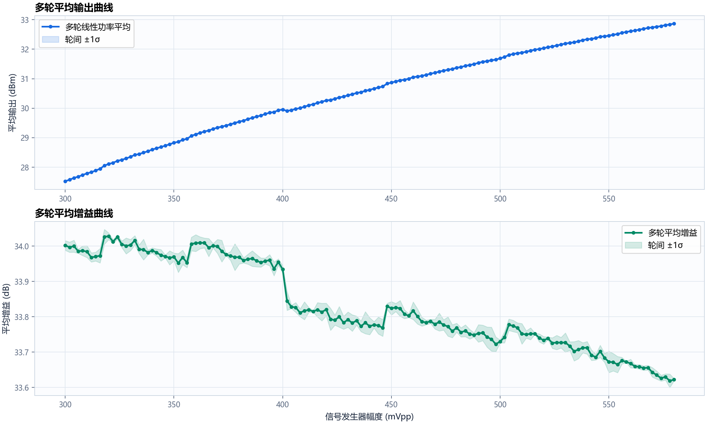
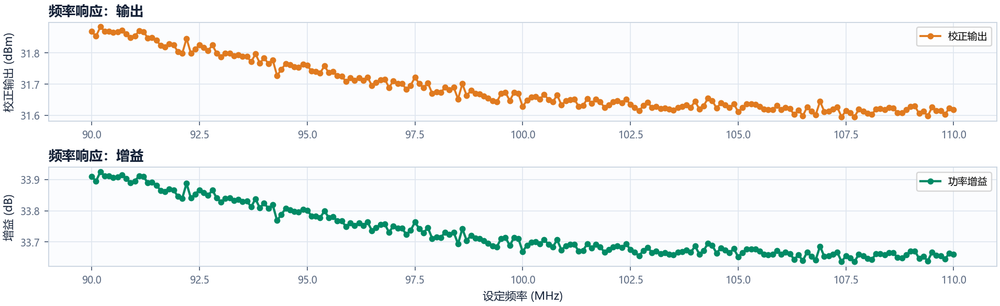

# 2026-10-20 放大器增益扫描自动程序

本仓库保存 RIGOL DG5352 Pro 与 DSA815 自动扫幅/扫频程序，以及 2026-10-20 最终采用的一组三轮扫幅数据和一轮完整扫频数据。

## 仪器与换算条件

- 信号发生器：RIGOL DG5352 Pro，CH1，50 Ω，Vpp。
- 频谱仪：RIGOL DSA815。
- 外置衰减链：1 + 2 + 3 + 30 + 12 = 48 dB。
- 输入功率按 50 Ω 正弦波由 Vpp 换算。
- 输出功率由频谱仪峰值加回 48 dB 后换算。
- 同一幅度的多轮 dBm 数据先转换到线性功率域求平均，再转换回 dBm。

## 最终数据

### 三轮扫幅

- 范围：580 → 300 mVpp。
- 步长：2 mVpp。
- 每轮 141 点，共 423 个原始测量点。
- 三轮均按最大幅度到最小幅度采集。

目录：[data/amplitude_sweep](data/amplitude_sweep)

- `amplitude_sweep_3rounds_20261020_195034.csv`：三轮逐点原始数据及换算结果。
- `amplitude_sweep_3rounds_20261020_195034.json`：扫描参数和 SCPI 配置。
- `amplitude_sweep_3rounds_20261020_195034.png`：三轮输出和增益对比曲线。
- `amplitude_sweep_3rounds_20261020_195034_average.csv`：141 个幅度点的平均值、标准差及各轮原始值。
- `amplitude_sweep_3rounds_20261020_195034_average.png`：平均输出与平均增益曲线。
- `amplitude_sweep_3rounds_20261020_195034_average_table.png`：完整平均数据表图片。



### 一轮扫频

- 范围：90 → 110 MHz。
- 步长：0.1 MHz。
- 固定发生器幅度：500 mVpp。
- 共 201 个频点。

目录：[data/frequency_sweep](data/frequency_sweep)

- `frequency_sweep_20261020_203135.csv`：逐频点原始数据及换算结果。
- `frequency_sweep_20261020_203135.json`：扫描参数和 SCPI 配置。
- `frequency_sweep_20261020_203135.png`：输出和增益随频率变化的曲线。
- `frequency_sweep_20261020_203135_table.png`：完整扫频数据表图片。



## 运行扫描程序

程序位于 [program](program) 目录。Windows 下可双击 `program/双击启动.cmd`，或运行：

```powershell
cd program
python -m pip install -r requirements.txt
python hat_gain_sweep.py
```

程序提供彼此独立的多轮扫幅和扫频功能。每个测量点都会触发 DSA815 单次扫描，并通过 `*OPC?` 等待扫描真正完成后再读取峰值。CSV 逐点写盘，完成、停止或异常时都会请求关闭发生器 RF 输出。

更完整的接线、VISA、SCPI 和操作说明见 [program/README.md](program/README.md)。

## 自检

```powershell
cd program
python -m unittest -v test_core.py
python hat_gain_sweep.py --self-test
```

当前版本共 17 项自动化测试。
